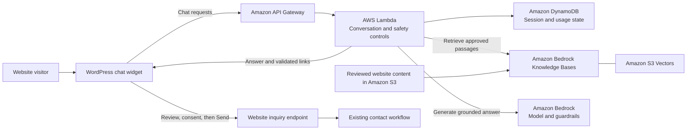

# Neti | Website AI assistant

Neti is a website assistant I built for Network Experts to help visitors understand its services, get basic troubleshooting guidance, and prepare an inquiry for the team. The project combines a compact WordPress chat experience with an AWS backend that grounds service answers in reviewed website content.

[Visit the website](https://networkexperts.la/) · [Read the launch announcement](https://www.linkedin.com/feed/update/urn:li:share:7524227618863439872/) · [Back to my portfolio](https://armandabiri99.github.io/#projects)

## Architecture

The chat API and inquiry submission are separate paths. The model helps answer questions. An inquiry reaches the website’s contact workflow only after the visitor reviews the fields, gives contact consent, and selects **Send inquiry**.

## Engineering decisions

- **Ground answers in approved content.** The backend retrieves relevant passages from a reviewed website corpus, checks source identity and links, and uses the evidence to produce a concise answer. The response can point visitors to the relevant service page or explain when the approved content cannot confirm a detail.
- **Keep support bounded.** Basic help focuses on low-risk steps and routes account access and higher-risk issues to the appropriate support channel. Session controls, rate limits, and replay handling help manage retries and usage.
- **Make contact handoff explicit.** Visitors can correct their details and edit the area of interest before sending. Structured inquiry fields travel through the website’s contact path. They are excluded from the model request.
- **Support controlled releases.** I used Terraform for infrastructure configuration and separated development from production. Validation covered browser interactions, request handling, grounded answers, and review and consent behavior.

## What this demonstrates

End-to-end delivery of a customer-facing AI feature across frontend UX, serverless AWS infrastructure, retrieval, and operational safeguards. The public launch demonstrates the website integration. AI and help availability can vary with operational settings.

This repository page is a portfolio case study. Application source, deployment configuration, and internal artifacts are private.
