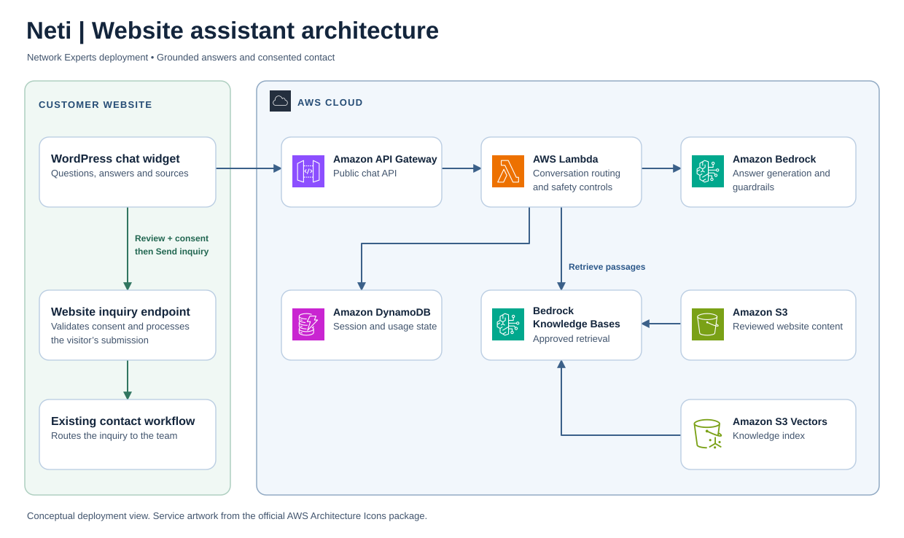

# Neti | Website AI assistant

Neti is a website AI assistant designed to be adapted for customer organizations in any industry. It answers questions from each organization’s approved content and offers a reviewed contact handoff. I built and launched the first implementation for Network Experts on WordPress and AWS.

[Visit the website](https://networkexperts.la/) · [Read the launch announcement](https://www.linkedin.com/feed/update/urn:li:share:7524227618863439872/) · [Back to my portfolio](https://armandabiri99.github.io/#projects)

## Architecture

*Conceptual view of the Network Experts deployment. Service artwork from the [official AWS Architecture Icons package](https://aws.amazon.com/architecture/icons/).*

The chat API and inquiry submission are separate paths. The model helps answer questions. An inquiry reaches the website’s contact workflow only after the visitor reviews the fields, gives contact consent, and selects **Send inquiry**.

## Adapting Neti for another industry

The same approach can be tailored to a retailer answering product and policy questions, a manufacturer explaining capabilities and qualifying quote requests, or a professional services firm helping visitors find the right team. Each customer supplies its branding, reviewed knowledge, approved actions, and inquiry destination. A new deployment also needs its own privacy and safety review, particularly where sensitive information or regulated advice is involved.

Network Experts is the deployment shown here. The examples describe how the architecture can be applied to other customers.

## Engineering decisions

- **Ground answers in approved content.** The backend retrieves relevant passages from a reviewed website corpus, checks source identity and links, and uses the evidence to produce a concise answer. The response can point visitors to the relevant service page or explain when the approved content cannot confirm a detail.
- **Keep support bounded.** Basic help focuses on low-risk steps and routes account access and higher-risk issues to the appropriate support channel. Session controls, rate limits, and replay handling help manage retries and usage.
- **Make contact handoff explicit.** Visitors can correct their details and edit the area of interest before sending. Structured inquiry fields travel through the website’s contact path. They are excluded from the model request.
- **Support controlled releases.** I used Terraform for infrastructure configuration and separated development from production. Validation covered browser interactions, request handling, grounded answers, and review and consent behavior.

## What this demonstrates

End-to-end delivery of a customer-facing AI feature across frontend UX, serverless AWS infrastructure, retrieval, and operational safeguards. The public launch demonstrates the website integration. AI and help availability can vary with operational settings.

This repository page is a portfolio case study. Application source, deployment configuration, and internal artifacts are private.
